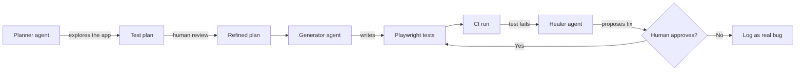

# ai-qa-lab

[](https://github.com/starobogatov/ai-qa-lab/actions/workflows/playwright.yml)
[](https://starobogatov.github.io/ai-qa-lab/)

AI-assisted test automation lab built with **Playwright + TypeScript**, using **Playwright Test Agents** (planner, generator, healer) against [saucedemo.com](https://www.saucedemo.com).

The goal: explore how QA changes when AI agents write and maintain tests, and what guardrails a human still needs to put around them.

---

## Why this project

After 9+ years in QA, most of it building Java automation frameworks (Selenide, Appium, REST-assured), I wanted to see how far AI agents can take test automation today, and where they still need human judgment. This lab is where I try that out in practice.

## Tech stack

- **Playwright** + **TypeScript**
- **Playwright Test Agents** (planner, generator, healer), run through Claude Code
- **Page Object Model**
- **storageState** session reuse: each SauceDemo user logs in once in a setup project
- **GitHub Actions** CI on every push and pull request
- **Allure** report published to GitHub Pages, with trend history

## How the AI workflow works



1. **Planner** explores saucedemo and drafts a test plan ([specs/saucedemo-login-checkout.plan.md](specs/saucedemo-login-checkout.plan.md)).
2. I **review the plan** and fix weak spots: wrong assumptions, missing coverage, fragile locators.
3. **Generator** turns the refined plan into Playwright tests using page objects.
4. Tests run in **CI**. When something breaks, the **healer** proposes a fix, and a human decides whether it's a broken test or a real bug.

## What's covered

- **Login:** valid and invalid credentials, empty fields, case sensitivity, locked-out user, protected pages, logout
- **Cart:** add and remove items, badge and button state, persistence across reload
- **Checkout:** happy path, price totals, cancel and navigation, data-driven form validation
- **Special users:** `problem_user`, `error_user` and `performance_glitch_user`
- **Known bugs** are marked with `test.fail()`, so they're documented instead of hidden or asserted as "expected"
- **My own extra scenarios:** completed order resubmitted via the Back button, and cart carried over to a different user after logout

Current suite: **39 tests per browser** across Chromium, Firefox and WebKit, including **6 known-bug tests** marked as expected failures.

## Run it locally

```bash
git clone https://github.com/starobogatov/ai-qa-lab.git
cd ai-qa-lab
npm ci
npx playwright install
```

| Command | What it does |
|---|---|
| `npm test` | Run the suite in Chromium |
| `npm run test:all` | Run in Chromium, Firefox and WebKit |
| `npm run test:headed` | Watch the browser while tests run |
| `npm run test:ui` | Playwright UI mode |
| `npm run report` | Open the Playwright HTML report |
| `npm run allure` | Generate and open the Allure report |

## Project structure

```
.claude/agents/   # Playwright Test Agent definitions (planner, generator, healer)
specs/            # agent-generated test plans
tests/
  pages/          # page objects (Login, Inventory, Cart, Checkout)
  support/        # auth helpers and test users
  auth.setup.ts   # logs each user in once and saves the session
  *.spec.ts       # test specs
.github/workflows/playwright.yml   # CI + Allure report deploy
```

## Lessons learned so far

- AI agents are fast at producing tests, but the **plan review** is where quality is decided.
- Agents sometimes treat a real bug as "expected behaviour". A human needs to make that call.
- Good locators and page objects still matter, even when an AI writes the code.

## Roadmap

- [ ] Run the **healer agent** on intentionally broken tests and document the results
- [ ] Add an **LLM eval framework** to score agent output automatically
- [ ] Add process and sequence diagrams for the main user flows

## Author

**Eduard Starobogatov**, QA lead moving toward AI-assisted QA and product ownership.
[LinkedIn](https://linkedin.com/in/eduard-starobogatov-26a631138)
